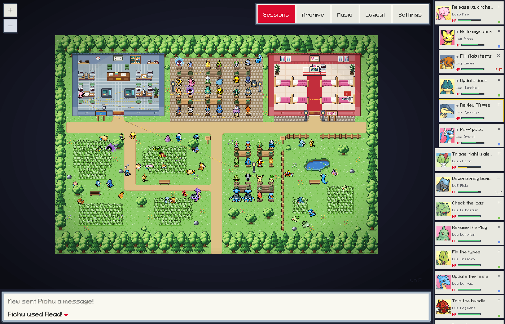
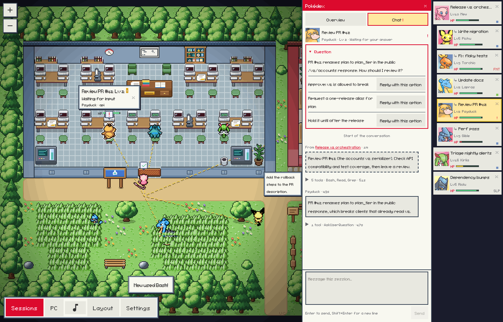
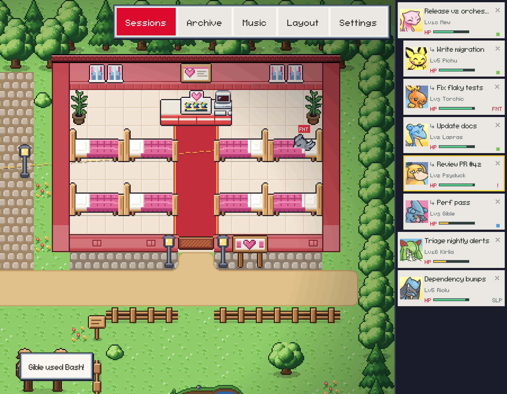
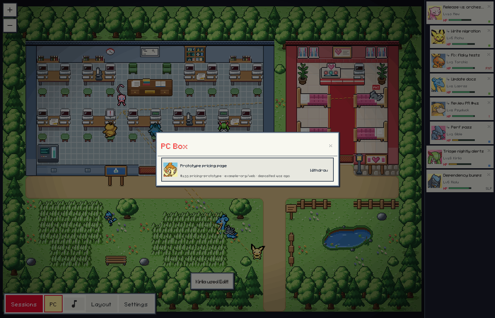
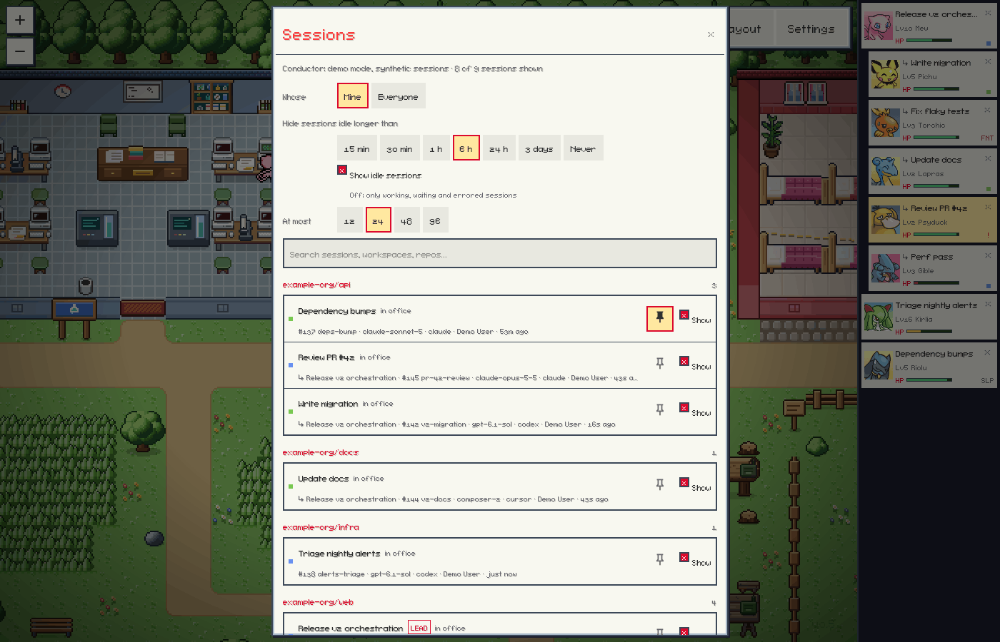
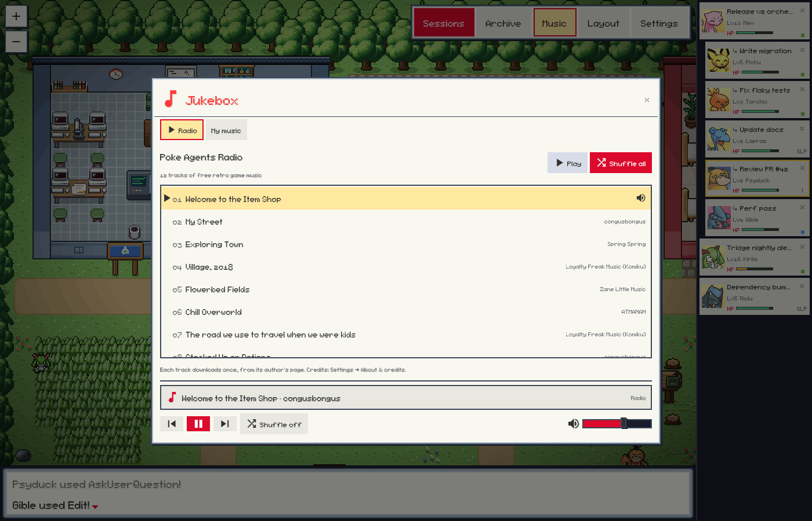
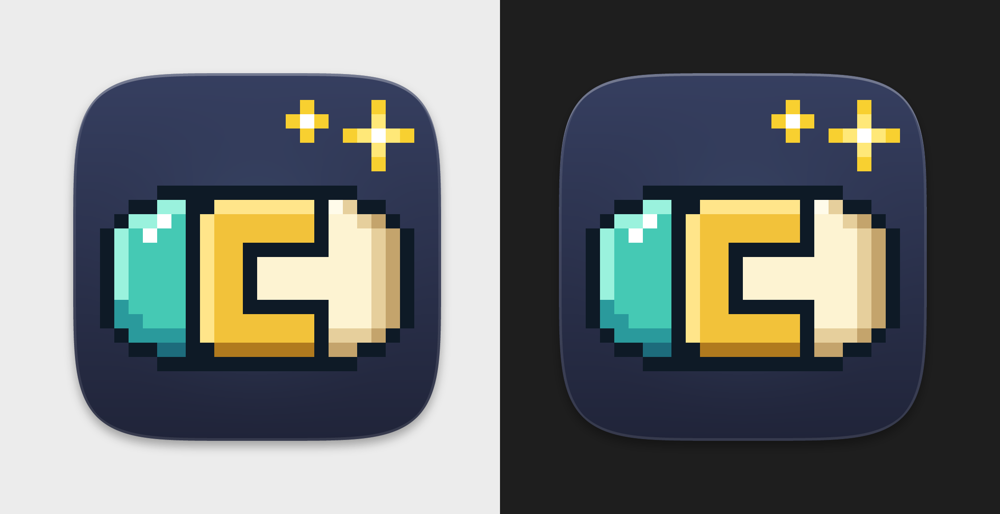
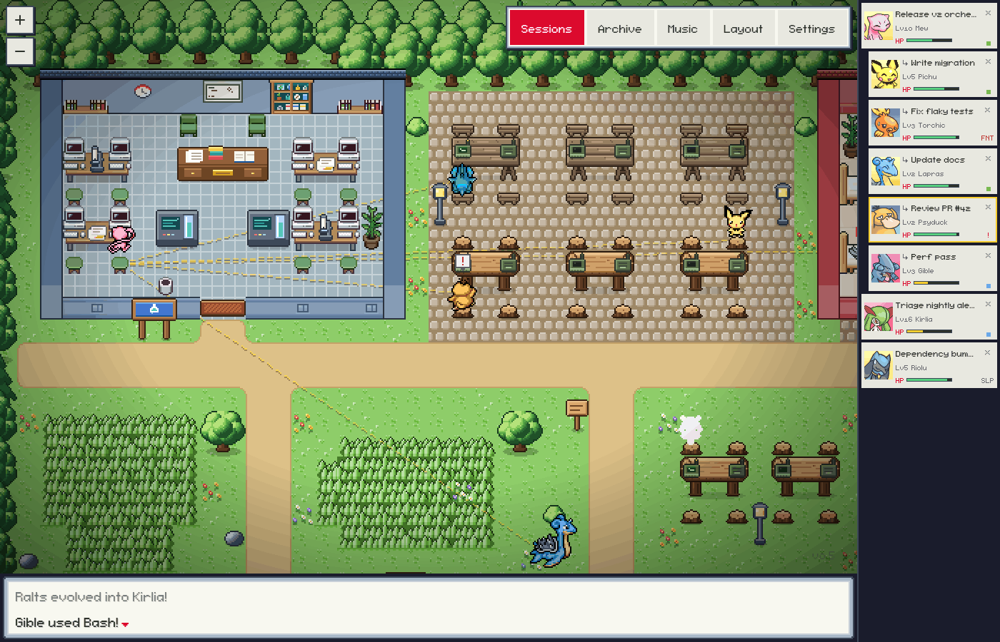
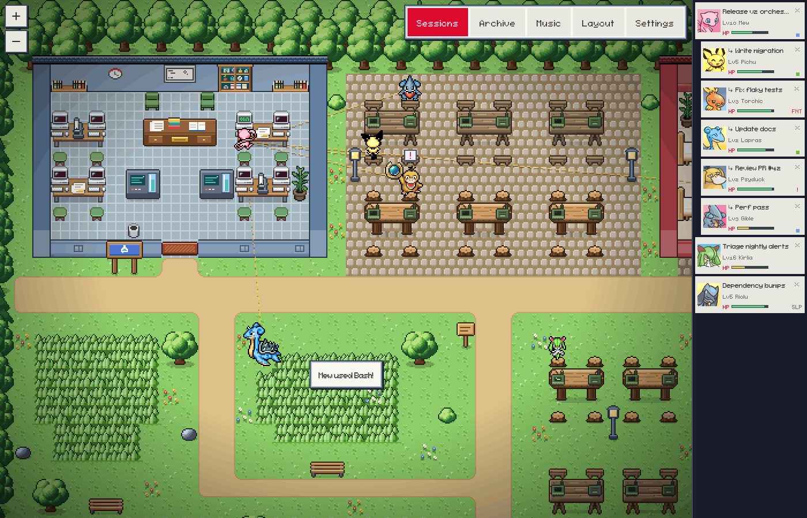

# Poke Agents

Watch your [Conductor](https://conductor.build) cloud sessions as Pokémon in a small pixel-art town.



Poke Agents is inspired by and based on [Pixel Agents](https://github.com/pixel-agents-hq/pixel-agents) by Pablo De Lucca, under the [MIT License](LICENSE). The screenshots in this README come from the built-in [demo](#demo), with synthetic sessions.

## What It Is

Poke Agents is a visualizer for Conductor. Each cloud session is a Pokémon: it works at a desk while the session runs tools, wanders and naps when the session is idle, faints when it errors, and calls for you when it needs an answer. When one session starts or messages others, the town draws the links between them and the messages they send. It runs as a Mac app or in a browser window next to Conductor.

All coding happens in Conductor, with your Conductor settings: models, environment, repositories and agents stay configured there.

- **What it reads:** your account, your cloud workspaces and their sessions, and each session's status and messages, through Conductor's public API with GET requests.
- **What it can ask Conductor to do:** send a message to a session (**Send**, **Revive** and a pending question's options), stop a session's turn, archive a session (**Deposit in PC**) and unarchive one (**Withdraw**). Each happens only when you click it in an office opened with its token, and Conductor does the work.
- **What it never does:** start sessions or agents, run code, edit repositories, or store or change your Conductor settings or API key. **Hide** and **Pin** only change what Poke Agents shows; Conductor isn't told.
- **What it stores:** its own view of your sessions under `~/.pixel-agents/` (see [Configuration](#configuration)): the scope, hidden and pinned sessions, seats and each session's Pokémon.

The exception is `--claude`, the local Claude Code mode from Pixel Agents. It is opt-in, `npm start` never turns it on, and the Mac app doesn't offer it. It launches Claude Code in a terminal inside the office and, after you agree in the app, installs hooks in `~/.claude/settings.json`.

## Features

- **The town.** Working sessions sit at the desks in the Lab, with Leads at the lectern. Idle ones wander and nap in the Meadow's tall grass and around the pond. Fainted ones lie in the Pokémon Center's beds until they are revived. **Layout → Templates** switches between the town and the classic Pixel Agents office.
- **A Pokémon per session.** Each visible session is a Pokémon that keeps its species. It works at its desk while the session runs tools, nods along on read tools, and hops when a turn ends.
- **Levels and evolution.** `Lv` comes from the session's message count. A Pokémon evolves at Lv 16 and Lv 36 when its line has later stages.
- **Status conditions.** `SLP` when a session has been idle for a while, `FNT` when it errors, and `!` when it waits for your answer or a permission.
- **Leads are legendaries.** A session that created other sessions is a Lead and appears as a legendary Pokémon that doesn't evolve. Its new sessions are thrown out of a capsule from where it stands, and a session that leaves is recalled into one.
- **Links and messages.** Lines connect sessions that created, messaged or read each other. When one session messages another, a capsule flies between them with a short preview.
- **Pokédex.** Click a Pokémon to open its Pokédex. **Overview** shows the workspace, repository, model and harness, status, an HP bar for the context left, the task, recent tool steps and messages with other sessions, and the actions Open in Conductor, Send message, Revive, Stop, Deposit in PC, Hide and Pin.
- **Chat.** The Pokédex's **Chat** tab shows the conversation: your messages, the agent's replies, each turn's tool steps folded into one line, and messages to and from other sessions. **Load earlier** fetches older messages from Conductor. The box at the bottom sends a reply.
- **Pending questions.** When a session waits on a question (Claude's AskUserQuestion, a plan to approve, or a Codex question), the Pokédex shows it with its options. **Reply with this option** sends the option's text as a normal message.
- **PC Box.** Archived sessions, with their Pokémon's portraits. **Withdraw** brings one back into the town.
- **Sessions.** Choose which sessions appear: your workspaces or the whole organization, an activity window, idle sessions on or off, a cap, and per-session hide and pin, with search.
- **Party bar.** Each visible session as a party slot with portrait, name, level, HP and status. Leads come first with their sessions under them, and a slot blinks while its session needs you.
- **Battle log.** An optional one-line ticker of events such as "Pichu used Bash!" or "Torchic fainted!".
- **Sounds.** Each Pokémon's cry when its session needs you, faints, arrives or evolves, and original chiptune effects for level-ups, capsules and messages. See [Sounds](#sounds).
- **Jukebox.** Background music: Poke Agents Radio, a built-in station of freely licensed retro game tracks, or your own music. See [Music](#music).
- **Mac app.** The same office in its own window, with notifications when a session needs you or faints and a Dock badge counting the sessions waiting on you. See [Mac App](#mac-app).
- **Demo mode.** A scripted office of synthetic sessions, for trying Poke Agents without a Conductor account. See [Demo](#demo).

Turning the Pokémon theme off in Settings brings back the Pixel Agents look. **Layout** opens Pixel Agents' layout editor for floors, walls, furniture and Areas (see [Pixel Agents' README](https://github.com/pixel-agents-hq/pixel-agents#readme) and [docs/external-assets.md](docs/external-assets.md)).





### Using the Office

- Click a Pokémon or its party slot to open its Pokédex. Cmd-click (Ctrl-click) or double-click opens the session in Conductor.
- In the **Chat** tab, Enter sends your reply and Shift+Enter starts a new line.
- **Sessions** in the toolbar opens the Sessions modal, **PC** the PC Box, and **Music** the Jukebox.
- The × on a Pokémon's card or party slot hides the session. Find it again in Sessions.
- **Escape** closes the window on top: a confirmation, then a modal, then the Pokédex.
- **Settings** has the Pokémon theme, Show connections and Battle log switches, the [Sound](#sounds) controls, and **About & credits**: what Poke Agents is, and the artists of the sprites in use.

Session actions are the only writes Poke Agents makes to Conductor, and each happens only when you click it in an office opened with its token:

| Action                     | What it does in Conductor                                                                    |
| -------------------------- | -------------------------------------------------------------------------------------------- |
| Send message, Chat replies | Sends your text to the session.                                                              |
| Reply with this option     | Sends the option's text to the session as a normal message.                                  |
| Revive                     | Sends "continue" to a fainted (errored) session.                                             |
| Stop                       | Cancels the session's turn. Asks first, because Conductor drops messages still queued.       |
| Deposit in PC              | Archives the session. Asks first. The session leaves the town and is listed in the PC Box.   |
| Withdraw                   | Unarchives a session from the PC Box. It walks back in, even if it was idle past the window. |



### How Visibility Works

Poke Agents polls Conductor for the sessions in scope and shows up to a cap of them. Change these in the Sessions modal; the choices are saved.

- **Scope:** your workspaces (default) or the whole organization.
- **Activity window:** workspaces and sessions active in the last 6 hours by default. **All (30d)** covers the last 30 days.
- **Show idle:** on by default. Off keeps only working, waiting and errored sessions.
- **Cap:** 24 sessions by default. When more are in scope, they are ranked: pinned, waiting for you, working, errored, Leads with visible active sessions, then most recent activity. A shown session stays until it falls 4 places past the cap, so the town doesn't flicker. At most 12 sessions per Lead are shown; the rest are listed in the Sessions modal.
- **Hide** removes a session from the town until you show it again. **Pin** always shows it.

Sessions that never started (no name, no model and no messages) are ignored. A session walks in once its level is known, so the first start on a machine fills the town over a minute or two. The session whose Pokédex is open updates every few seconds, along with up to 4 sessions it worked with in the last 15 minutes. The others are polled less often the longer they are idle.



### Leads and Links

A session becomes a Lead when it creates another session with a first message, for example with `conductor workspace create --message` or `conductor session create`. Lines between sessions show how they are connected:

- solid dashes: the Lead created that session
- dots: one session messaged the other
- faint: one session read the other's messages

### Sounds

Sound is on by default and starts after your first click, tap or key press in the office: browsers keep audio locked until then, and nothing that happened earlier is played late.

| When                                                 | You hear                                            |
| ---------------------------------------------------- | --------------------------------------------------- |
| A session needs your answer or a permission          | An alert, then its Pokémon's cry                    |
| A session errors (faints)                            | Its cry, pitched down, and a falling tone           |
| A fainted session works again                        | A rising heal arpeggio                              |
| A Pokémon levels up                                  | A short level-up arpeggio                           |
| A Pokémon evolves                                    | A rising shimmer, then the new species' cry         |
| A Lead creates a session                             | A capsule throw, the pop, and the new Pokémon's cry |
| Any other session appears                            | The pop and its cry                                 |
| One session messages another                         | A whoosh                                            |
| A session leaves (hidden, deposited or out of scope) | A recall zap                                        |
| The selected or a pinned session finishes its turn   | A soft two-note tone                                |
| You open a Pokédex                                   | That Pokémon's cry                                  |

At most four sounds play a second, one cry at a time, with a cooldown per session and nothing for five seconds after the office connects. **Settings → Sound** has the **Sounds** switch, a volume slider, **Cries**, **Alerts** and **Effects** toggles, and a test button for each sound.

**Cries** are the official cries from the [PokéAPI cries](https://github.com/PokeAPI/cries) project. After your first click, Poke Agents downloads the cry of each species in the town from `raw.githubusercontent.com`, once, into `~/.pixel-agents/cache/cries/`. With **Cries** off it downloads none. The other effects are original chiptune sounds synthesized in the app.

**Sound pack.** Files in `~/.pixel-agents/sounds/` replace the effects. Name each after the effect it replaces, with the extension `.ogg`, `.mp3` or `.wav` (for example `levelUp.ogg`): `alert`, `done`, `faint`, `heal`, `levelUp`, `evolution`, `ballThrow`, `ballPop`, `recall`, `message`, `blip`. Each file must be an audio file of at most 2 MB. Use only sounds you have the right to use. Cries can't be replaced.

`--no-sounds` (or `POKE_AGENTS_SOUNDS=off`) stops cry and radio downloads and the sound pack; the synthesized effects follow the Settings switch.

### Music

The Jukebox (**Music** in the toolbar, or **Jukebox…** under Settings → Sound) plays background music. It opens on the radio until you pick another source.

- **Radio** (any platform): Poke Agents Radio, 12 original chiptune and retro RPG tracks for a town, a route, indoors, a calm night and a battle. Their authors released them under CC0 or CC BY (see [Radio credits](#radio-credits)); none is a cover or arrangement of game music. Each track downloads once, the first time it plays or is queued next, from its author's page on `opengameart.org` or `incompetech.com` into `~/.pixel-agents/cache/music/radio/`, and plays only if it matches the size and SHA-256 pinned in `server/src/music/radioCatalog.ts`. The repository holds no audio. `--no-radio` (or `POKE_AGENTS_RADIO=off`) turns the radio off.
- **My music** (any platform): audio files you own in `~/.pixel-agents/music/`, one folder per game or album. MP3, M4A/AAC, OGG/Opus, WAV and FLAC play; Apple Lossless and copy-protected `.m4p` files don't. **Open folder** creates the folder and opens it.
- **Apple Music** (macOS): **Look in my Music library** finds albums whose album or artist name contains "Pokémon" and plays them in the Music app. To queue an album, the Jukebox fills a playlist named "Poke Agents Jukebox" in your library. A pasted `music.apple.com` link opens in Music.
- **Spotify** (macOS, with the Spotify app): paste an `open.spotify.com` or `spotify:` album, playlist or track link, then play or shuffle it in Spotify.

The first time the Jukebox controls Music or Spotify, macOS asks whether your terminal (or the Poke Agents app) may control it. Cries and alerts briefly lower radio and folder music. Poke Agents never downloads, streams or bundles game soundtracks: the official Pokémon soundtracks are commercial albums, and there is no free, legal download.



## Requirements

- For your live sessions: a [Conductor](https://conductor.build) Pro account with **cloud** workspaces. Conductor's public API needs Pro and only covers cloud workspaces. The [demo](#demo) needs no Conductor account.
- Node.js 20 or later, npm and git. Building the Mac app needs Node.js 22.12 or later.
- For the Mac app, macOS 13 or later. For the browser window, any browser; on macOS, `npm start` opens Chrome, Edge, Brave, Chromium or Vivaldi as an app window when one is installed.

## Install

### Mac App

The Mac app is the same office in its own window. It only shows Conductor: it never runs coding agents, edits repositories or changes your Conductor settings, and it has no Claude Code tracking, terminal or hooks.



Build it on your Mac, from a clone:

```bash
git clone https://github.com/joshle298/poke-agents.git
cd poke-agents
npm ci
npm run app:mac
open "desktop/release/mac-arm64/Poke Agents.app"   # Apple silicon; desktop/release/mac/ on Intel
```

The first build downloads Electron (about 120 MB) and takes a few minutes. `npm run app:mac` builds for the Mac you run it on; `npm run app:mac:all` builds both architectures, and a zip of each app lands in `desktop/release/` too. Drag the app to `/Applications` to keep it.

A build made on your Mac is signed ad hoc, so macOS opens it normally there. The app has no Apple Developer ID signature and isn't notarized, so a copy built elsewhere needs Control-click → **Open** (on macOS 15 and later: open it once, then **System Settings → Privacy & Security → Open Anyway**). Apple silicon refuses an app with no signature at all, so build it on a Mac.

On the first launch the office shows **Connect to Conductor** (see [Sign In](#sign-in)). If the Conductor CLI is already signed in, macOS asks instead whether `security` may use the Keychain item `com.conductor.cli` (the app reading that sign-in). Once Conductor connects, macOS asks whether Poke Agents may send notifications.

- **Notifications:** when a session starts waiting for your answer or a permission, or faints, Poke Agents posts a notification such as "Pikachu needs your answer". Clicking it opens that session's Pokédex. There are none while the window is in front, none for sessions already waiting when the app starts, and at most one per session and reason every 2 minutes.
- **Dock badge:** the number of sessions waiting for your answer or a permission. macOS shows it only when Poke Agents may send notifications (**System Settings → Notifications → Poke Agents**, with **Badge app icon** on).
- **Window:** Cmd-W keeps Poke Agents in the Dock and Cmd-Q quits it. **Poke Agents → Settings…** (Cmd-,) opens Settings. Web links open in your browser and **Open in Conductor** opens the Conductor app.
- **With the command line:** the app and `npm start` share one office on port 41510. If `npm start` is running, the app opens that office, and the other way round.
- **Demo:** quit the app, then run `open -a "Poke Agents" --args --demo`.
- **Update:** quit the app, then `git pull && npm ci && npm run app:mac`, and replace the copy in `/Applications`.
- **Uninstall:** sign out in **Settings → Conductor** (or delete the `com.joshle298.pokeagents.conductor` item in Keychain Access), quit the app, move it to the Trash, and delete `~/Library/Application Support/Poke Agents/` (its window position). Delete `~/.pixel-agents/` too if you don't use the command line. Leave the `com.conductor.cli` item: it belongs to the Conductor CLI.

`npm run app:dev` runs the app unpackaged, with **View → Toggle Developer Tools**.



### Command Line

```bash
git clone https://github.com/joshle298/poke-agents.git
cd poke-agents
npm ci       # installs dependencies and builds dist/
npm start    # opens the office in an app window
```

The first `npm ci` builds the app, which takes about a minute, and ends with `Built dist/ in … s`. npm warns about deprecated packages and, from npm 11.16, lists dependency install scripts that no `allowScripts` entry covers; the build doesn't need them. On a machine with no browser to open, `npm start` prints the URL instead. To update, run `git pull && npm ci && npm start`.

Or run it from GitHub without cloning:

```bash
npx github:joshle298/poke-agents --open
```

npm 12 and later refuse git packages by default (`EALLOWGIT`), so add `--allow-git=all`:

```bash
npx --allow-git=all github:joshle298/poke-agents --open
```

The first run downloads about 125 MB of build tools and builds the app, which takes about 20 seconds before the office starts. Don't run `npx poke-agents`: that npm name belongs to an unrelated package.

The command prints a URL with a `?token=`. Treat it as a secret: whoever has it can use the session actions (send a message, stop, archive). A browser without the token can only watch.

### Demo

```bash
npm ci
npm run demo   # the same as: node dist/cli.js --demo --open
```

The demo plays a scripted story with synthetic sessions instead of connecting to Conductor. It needs no Conductor account. A Lead, "Release v2 orchestration", spawns five sessions in the first 20 seconds. They run tools, message the Lead and level up. "Fix flaky tests" faints and the Lead revives it, "Update docs" finishes early and falls asleep, "Review PR #42" waits on a question for you, and "Triage nightly alerts" evolves. The finished "Prototype pricing page" is in the PC Box.

Everything in the office works on the demo's sessions, and nothing reaches Conductor: **Open in Conductor** says there is nothing to open. Sprites, cries and radio tracks download as usual. The first round, about five minutes long, plays the same way every time; then the Lead hands out new tasks. `--demo-seed <n>` varies the history and later rounds, and `--demo-speed <x>` plays the story faster or slower. The demo keeps its seats in its own file and never replaces an office that shows your real sessions.



## Sign In

Poke Agents needs a Conductor API key (API keys need Pro). Connect in the office:

1. Open the office. Without a key it shows **Connect to Conductor**.
2. Click **Get an API key**. Conductor's API keys page opens in your browser. Create a key and copy it.
3. Paste it into the card (or click **Paste**) and click **Connect**.

Poke Agents checks the key with Conductor, and your sessions walk in without a restart. On macOS it keeps the key in its own Keychain item (`com.joshle298.pokeagents.conductor`), so you stay signed in. Poke Agents creates that item with `/usr/bin/security`, which macOS then trusts to read it, so **any app you run can read the key without a prompt** (`security find-generic-password -s com.joshle298.pokeagents.conductor -w`). That is the same exposure as an environment variable: the Keychain keeps the key encrypted on disk and away from other users of the Mac, not from your own apps. Linux and Windows have no Keychain: the key lasts until the office stops, so set `CONDUCTOR_API_KEY` to stay signed in.

In the Mac app, when you come back from the browser with a Conductor key copied, the card offers **Use key from clipboard**. It shows the key's prefix and last four characters and fills the field; nothing is sent until you click **Connect**. The app looks at the clipboard only then and when you click **Paste**.

**Settings → Conductor** shows the account, where the key came from and, for a key Poke Agents saved, **Sign Out of Conductor…**. Signing out forgets only that key. If the Conductor CLI is signed in, the office switches to that sign-in and says so (macOS may ask whether `security` may use `com.conductor.cli`).

Poke Agents uses the first key it finds:

1. `CONDUCTOR_API_KEY`, then `CONDUCTOR_API_TOKEN`. They come first, so the office can't replace them: change the variable and restart Poke Agents.
2. The key you connected with in the office.
3. On macOS, the sign-in that `conductor auth login` saved in the Keychain (service `com.conductor.cli`). Poke Agents reads it but never changes or deletes it.

To sign in with the Conductor CLI instead: on a Mac the CLI ships inside the Conductor app and usually isn't on your `PATH`, so run it by its full path:

```bash
"$HOME/Library/Application Support/com.conductor.app/bin/conductor" auth login
```

Then open **Prefer the CLI?** on the card and click **Reconnect** in the Mac app (or choose **Poke Agents → Reconnect to Conductor**), or restart `npm start`. When macOS asks whether `security` may use `com.conductor.cli`, choose **Allow**. **Always Allow** stops the prompt, but it adds `/usr/bin/security` to the item's access list, so any app you run can then read your Conductor token without asking, as it can read the key connected in the office.

## Configuration

| Flag                     | Default      | Effect                                                                                                                                                                                                                                                           |
| ------------------------ | ------------ | ---------------------------------------------------------------------------------------------------------------------------------------------------------------------------------------------------------------------------------------------------------------- |
| `--open`, `--app`        | off          | Open the office in a Chromium app window, through a one-time link so the token never appears on the browser's command line. macOS tries Chrome, Edge, Brave, Chromium, Vivaldi and Chrome Canary in that order, then the default browser. Linux uses `xdg-open`. |
| `--browser <id>`         | first found  | Use this browser for `--open`. `poke-agents --help` lists the ids.                                                                                                                                                                                               |
| `--port`, `-p <number>`  | `41510`      | Port to listen on. When 41510 is busy and no `--port` was given, a free port is used instead.                                                                                                                                                                    |
| `--host <address>`       | `127.0.0.1`  | Address to bind to. `0.0.0.0` exposes the office to your network; other devices can watch it by IP address (a host name needs `--allowed-host`).                                                                                                                 |
| `--allowed-host <name>`  | none         | Also accept this host name, such as a reverse proxy's (Tailscale Serve) or `my-mac.local`, for watching and for the tokened URL. Repeatable. Other host names are refused.                                                                                       |
| `--rotate-token`         | off          | Replace the office token. Every URL that carried the old one stops working.                                                                                                                                                                                      |
| `--no-conductor`         | Conductor on | Don't connect to Conductor.                                                                                                                                                                                                                                      |
| `--conductor-budget <n>` | `120`        | Most Conductor API requests per minute.                                                                                                                                                                                                                          |
| `--no-sprites`           | sprites on   | Never download sprites. The office shows the Pixel Agents characters.                                                                                                                                                                                            |
| `--no-sounds`            | sounds on    | Never download cries or radio tracks, or serve the sound pack. Synthesized effects still follow Settings → Sound.                                                                                                                                                |
| `--no-radio`             | radio on     | Turn off [Poke Agents Radio](#music): the Jukebox lists no radio and downloads no tracks.                                                                                                                                                                        |
| `--demo`                 | off          | Play the scripted [demo](#demo) with synthetic sessions instead of connecting to Conductor. Not with `--claude`.                                                                                                                                                 |
| `--demo-seed <n>`        | `42`         | Vary the demo's generated history, replies and later rounds. The first round is the same for every seed. Implies `--demo`.                                                                                                                                       |
| `--demo-speed <x>`       | `1`          | Demo speed factor, from 0.25 to 20. Implies `--demo`.                                                                                                                                                                                                            |
| `--claude`               | off          | Also track local Claude Code sessions, as Pixel Agents does: hooks (after you consent in the app), the embedded terminal and **+ Agent**.                                                                                                                        |
| `--no-terminal`          | terminal on  | With `--claude`: no embedded terminal, so agents can be watched but not launched from the browser.                                                                                                                                                               |

| Environment variable           | Effect                                                                         |
| ------------------------------ | ------------------------------------------------------------------------------ |
| `CONDUCTOR_API_KEY`            | Conductor API key. Checked first.                                              |
| `CONDUCTOR_API_TOKEN`          | Used when `CONDUCTOR_API_KEY` is not set.                                      |
| `CONDUCTOR_API_URL`            | Conductor API base URL. Default `https://api.conductor.build`.                 |
| `POKE_AGENTS_SPRITES`          | `off` disables sprite downloads, like `--no-sprites`.                          |
| `POKE_AGENTS_SOUNDS`           | `off` disables cry and radio downloads and the sound pack, like `--no-sounds`. |
| `POKE_AGENTS_RADIO`            | `off` turns off Poke Agents Radio, like `--no-radio`.                          |
| `POKE_AGENTS_CONDUCTOR_BUDGET` | Conductor API requests per minute when `--conductor-budget` is not given.      |
| `POKE_AGENTS_DEMO_SPEED`       | The demo's speed factor when `--demo-speed` is not given.                      |
| `POKE_AGENTS_SKIP_BUILD`       | `1` skips building `dist/` during `npm install` or `npm ci`.                   |

Poke Agents keeps its data in `~/.pixel-agents/`, shared with Pixel Agents. None of it is a Conductor setting, and none of it holds the Conductor token:

| File                    | Contents                                                                                                                                                             |
| ----------------------- | -------------------------------------------------------------------------------------------------------------------------------------------------------------------- |
| `standalone-state.json` | Seats, and each Conductor session's agent id and Pokémon (under `streamAgents`). With `--claude`, each agent's tool-call count (its level).                          |
| `conductor-state.json`  | The Sessions modal's scope, hidden and pinned sessions, recent withdrawals, and where Poke Agents last read each session. Entries untouched for 30 days are dropped. |
| `conductor.lock`        | Which office polls Conductor. Only one office per machine does.                                                                                                      |
| `demo-state.json`       | The demo office's seats (`--demo`), apart from the real office's.                                                                                                    |
| `standalone-token`      | The office token from the printed URL. `--rotate-token` replaces it.                                                                                                 |
| `config.json`           | Settings such as the Pokémon theme and sounds.                                                                                                                       |
| `layout.json`           | The office layout.                                                                                                                                                   |
| `cache/pmd/`            | Downloaded sprites and portraits.                                                                                                                                    |
| `cache/cries/`          | Downloaded Pokémon cries.                                                                                                                                            |
| `cache/music/radio/`    | Downloaded [Poke Agents Radio](#music) tracks, each checked against its pinned SHA-256.                                                                              |
| `sounds/`               | Your [sound pack](#sounds), if you add one.                                                                                                                          |
| `music/`                | Your [Jukebox](#music) albums, if you add some.                                                                                                                      |
| `music.json`            | The Apple Music and Spotify links you saved in the Jukebox.                                                                                                          |

The Mac app also keeps its window position in `~/Library/Application Support/Poke Agents/`.

## Privacy

- Poke Agents makes outbound requests only to:
  - the Conductor API, `api.conductor.build` (or `CONDUCTOR_API_URL`);
  - `raw.githubusercontent.com` for sprites, with `cdn.jsdelivr.net` as a fallback, and for cries;
  - `opengameart.org` and `incompetech.com` for radio tracks, each once, when it first plays;
  - `open.spotify.com/oembed`, once, when you save a Spotify link in the Jukebox.
- With the Pokémon theme off or `--no-sprites`, it fetches no sprites and no cries; with `--no-radio`, no radio tracks; with `--no-sounds`, neither cries nor radio tracks. The demo never contacts Conductor.
- Your Conductor key is never logged, passed on a command line or written to `~/.pixel-agents/`. A key you connect with in the office is kept in Poke Agents' own Keychain item on macOS (handed to `security` on its standard input) or, elsewhere, in memory until the office stops. That Keychain item trusts `/usr/bin/security`, so any app you run can read the key without a prompt, as it could read `CONDUCTOR_API_KEY`. Poke Agents reads the Conductor CLI's Keychain item but never changes it.
- Reads use GET requests. Writes to Conductor happen only for the [session actions](#using-the-office), when you click them.
- The office answers only under `localhost`, an IP address, the `--host` address or an `--allowed-host` name, so a web page that points its own domain at your computer (DNS rebinding) can't read your sessions.
- There is no telemetry or analytics.

## Troubleshooting

- **My local Conductor workspaces don't appear.** Conductor's public API only covers cloud workspaces. Local workspaces have no API.
- **The office shows Connect to Conductor.** No key was found. See [Sign In](#sign-in).
- **"That key was rejected by Conductor."** The key was mistyped or revoked. Create a new one with **Get an API key**.
- **The card says Conductor rejected the key in `CONDUCTOR_API_KEY` (or `CONDUCTOR_API_TOKEN`).** A key in the environment comes first, so the office can't replace it. Update the variable, then restart Poke Agents.
- **`conductor: command not found`.** On a Mac the Conductor CLI ships inside the Conductor app and isn't on your `PATH`. Connect in the office, or run the CLI by its full path (see [Sign In](#sign-in)).
- **`npm ci` stops with "Can't build dist/".** npm left out the build tools because of `--omit=dev` or `NODE_ENV=production`. Run `npm ci --include=dev`.
- **`npx` stops with `EALLOWGIT`.** npm 12 refuses git packages unless you add `--allow-git=all`.
- **`npm start` prints "Could not open a window".** No browser could be opened, for example over SSH. Open the printed URL yourself.
- **The office opens in a normal browser tab.** No supported Chromium browser was found. Install Chrome, or pick one with `--browser`.
- **The office says "This address isn't allowed".** You opened it under a host name the office doesn't accept, such as `my-mac.local`. Restart with `--allowed-host my-mac.local`, or open it by IP address.
- **The terminal says Conductor sessions are already tracked by another office.** Only one office per machine polls Conductor. Open that office, or stop it and start this one again.
- **Sessions update slowly, or the status line reports rate limiting.** Conductor limits API requests, and the limit may be shared with your sessions' own `conductor` CLI calls. Poke Agents halves its request rate after a rate-limit reply and recovers slowly. Lower the rate with `--conductor-budget`, or narrow the scope and cap in Sessions.
- **macOS asks whether `security` may use `com.conductor.cli`.** That is Poke Agents reading the sign-in `conductor auth login` saved. Choose Allow, or connect with an API key in the office instead, which doesn't prompt because any app you run can read that key (see [Sign In](#sign-in)).
- **macOS says Poke Agents "is damaged and can't be opened".** The app has no valid signature, usually because it was built on another computer. Build it on your Mac with `npm run app:mac`. For a copy from elsewhere: `xattr -dr com.apple.quarantine "/Applications/Poke Agents.app"`, then `codesign --force --deep --sign - "/Applications/Poke Agents.app"`.
- **The Mac app shows no notifications or Dock badge.** Check **System Settings → Notifications → Poke Agents** (allowed, with **Badge app icon** on). Notifications are skipped while the window is in front.
- **An installed web app can't connect after a restart.** Port 41510 was busy, so the office started on another port. Stop whatever holds 41510, or always pass the same `--port`.
- **No sound.** Click, tap or press a key in the office once: browsers keep audio locked until then. Check that **Sounds** is on in Settings and the volume is up.
- **No cries, but the other sounds play.** Cries download after your first click, so a species new to the town can miss its first cry. They are mostly Ogg files, which some Safari versions can't play. They also need the Pokémon theme and sprites on.
- **Pokémon show as office workers.** Sprites download in the background, and a Pixel Agents character shows until a sprite is ready. If it never changes, check that `raw.githubusercontent.com` or `cdn.jsdelivr.net` is reachable.

## Development

```bash
npm ci
npm run build                      # protocol generation, type check, lint, esbuild and Vite
node dist/cli.js --demo            # run the office with the demo sessions
npm test                           # unit, package-contract, Mac app helper and icon tests
```

See [CONTRIBUTING.md](CONTRIBUTING.md) for the full checks, the end-to-end tests and the Mac app checklist. Commits run [gitleaks](https://github.com/gitleaks/gitleaks) through a husky hook, so install it first. Use [Issues](https://github.com/joshle298/poke-agents/issues) for bugs and ideas.

Poke Agents is maintained by Josh Le ([@joshle298](https://github.com/joshle298)).

## Credits and Disclaimer

Poke Agents is a fan project and is not affiliated with, endorsed, sponsored or approved by Nintendo, The Pokémon Company, Creatures Inc., GAME FREAK inc. or Spike Chunsoft. Pokémon and Pokémon character names are trademarks of Nintendo, Creatures Inc. and GAME FREAK inc.

**Pixel Agents.** Poke Agents is built on [Pixel Agents](https://github.com/pixel-agents-hq/pixel-agents) by Pablo De Lucca, used under the MIT License. The classic office, its characters and most of its furniture come from Pixel Agents; its characters are based on [JIK-A-4, Metro City](https://jik-a-4.itch.io/metrocity-free-topdown-character-pack).

**Original art.** The app icon (the capsule with a gold C for Conductor), the capsule, and the town's art (grass, tall grass, paths, trees, the pond, the buildings and the Lab and Pokémon Center furniture) are original to Poke Agents and drawn in code by `scripts/generate-icons.mjs` and `scripts/generate-world-assets.mjs`.

**Sprites.** When the Pokémon theme is on, the app downloads sprites and portraits from the PMD Sprite Repository ([sprites.pmdcollab.org](https://sprites.pmdcollab.org), [PMDCollab/SpriteCollab](https://github.com/PMDCollab/SpriteCollab)) to a cache on your computer; the app itself ships none. Sprites credited to CHUNSOFT come from the Pokémon Mystery Dungeon games, © Nintendo, Creatures Inc., GAME FREAK inc. and Spike Chunsoft. Community sprites and portraits are © their credited artists and licensed under [CC BY-NC 4.0](https://creativecommons.org/licenses/by-nc/4.0/): use them only for non-commercial purposes. **Settings → About & credits** lists the artists for each species in use.

**Screenshots.** The screenshots in `docs/screenshots/` show PMD Sprite Repository sprites and portraits as the app draws them (scaled, and animated in the app): Psyduck (portraits: Morei, Felis-Licht, CHUNSOFT), Lapras (portraits: silverfox88, C_Pariah, CHUNSOFT), Mew (sprites: JFain, CHUNSOFT; portraits: Mojo, G〜, CHUNSOFT), Pichu (sprites: Spikey-Valentine, CHUNSOFT; portraits: C_Pariah, CHUNSOFT), Torchic (CHUNSOFT), Kirlia (sprites: JFain, CHUNSOFT; portraits: PhillipsYoung, CHUNSOFT), Chimchar (CHUNSOFT), Gible (portraits: G〜, JFain, CHUNSOFT) and Riolu (portraits: Fearless-Quit, CHUNSOFT); where only portraits are named, the sprites are CHUNSOFT's. They are used here under CC BY-NC 4.0 in a non-commercial project. Apart from these screenshots, the repository contains no Pokémon artwork.

**Cries.** When sounds are on, the app downloads Pokémon cries from the [PokéAPI cries](https://github.com/PokeAPI/cries) project (collected from Pokémon Showdown, Veekun and The Sounds Resource). Cries are © Nintendo, Creatures Inc. and GAME FREAK inc., fetched at runtime and not redistributed. The other sound effects are original and synthesized in the app.

### Radio credits

Poke Agents Radio plays these original tracks, each credited as title — author — license — source. The app shows the same list under **Settings → About & credits**, from `core/src/radioCredits.ts`. CC0 tracks are in the public domain; CC BY tracks are used under their license, unmodified (the station only lowers their playback volume). The files are downloaded from the source pages at runtime and are not in this repository.

- Welcome to the Item Shop — congusbongus — [CC0 1.0](https://creativecommons.org/publicdomain/zero/1.0/) — [opengameart.org](https://opengameart.org/content/welcome-to-the-item-shop)
- My Street — congusbongus — [CC0 1.0](https://creativecommons.org/publicdomain/zero/1.0/) — [opengameart.org](https://opengameart.org/content/my-street)
- Exploring Town — Spring Spring — [CC0 1.0](https://creativecommons.org/publicdomain/zero/1.0/) — [opengameart.org](https://opengameart.org/content/exploring-town)
- Village, 2018 — Loyalty Freak Music (Komiku) — [CC0 1.0](https://creativecommons.org/publicdomain/zero/1.0/) — [opengameart.org](https://opengameart.org/content/village-2018)
- Flowerbed Fields — Zane Little Music — [CC0 1.0](https://creativecommons.org/publicdomain/zero/1.0/) — [opengameart.org](https://opengameart.org/content/flowerbed-fields-loop)
- Chill Overworld — ATMANAN — [CC BY 4.0](https://creativecommons.org/licenses/by/4.0/) — [opengameart.org](https://opengameart.org/content/chill-overworld)
- The road we use to travel when we were kids — Loyalty Freak Music (Komiku) — [CC0 1.0](https://creativecommons.org/publicdomain/zero/1.0/) — [opengameart.org](https://opengameart.org/content/the-road-we-use-to-travel-when-we-were-kids)
- Stocked Up on Potions — congusbongus — [CC BY 4.0](https://creativecommons.org/licenses/by/4.0/) — [opengameart.org](https://opengameart.org/content/stocked-up-on-potions)
- Apple Cider — Zane Little Music — [CC0 1.0](https://creativecommons.org/publicdomain/zero/1.0/) — [opengameart.org](https://opengameart.org/content/apple-cider)
- Remember the time we use to play — Loyalty Freak Music (Komiku) — [CC0 1.0](https://creativecommons.org/publicdomain/zero/1.0/) — [opengameart.org](https://opengameart.org/content/remember-the-time-we-use-to-play)
- Airship Serenity — Kevin MacLeod (incompetech.com) — [CC BY 4.0](https://creativecommons.org/licenses/by/4.0/) — [incompetech.com](https://incompetech.com/music/royalty-free/index.html?isrc=USUAN1600046)
- 8-Bit RPG Battle/Encounter Theme — Wolfgang_ — [CC0 1.0](https://creativecommons.org/publicdomain/zero/1.0/) — [opengameart.org](https://opengameart.org/content/8-bit-rpg-battleencounter-theme)

## License

Poke Agents is inspired by and based on [Pixel Agents](https://github.com/pixel-agents-hq/pixel-agents) by Pablo De Lucca: it started from Pixel Agents' code and keeps much of it. Both are available under the [MIT License](LICENSE), which keeps the upstream copyright notice. The MIT License covers the source code only, not the downloaded sprites, portraits, cries or music, or the sprites shown in the screenshots.

If Poke Agents makes your agents more fun to watch, star it on GitHub.
